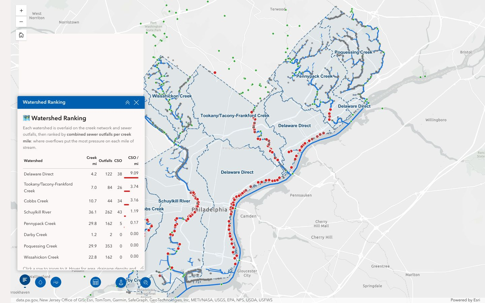
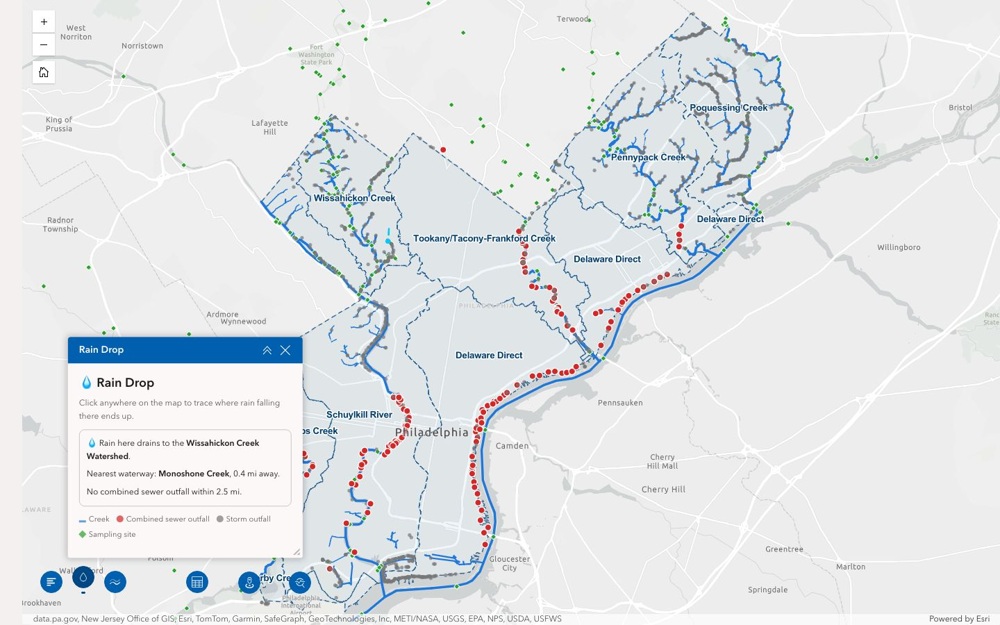
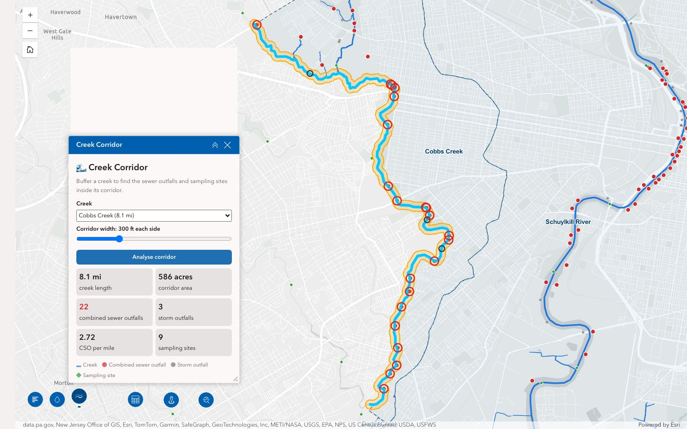
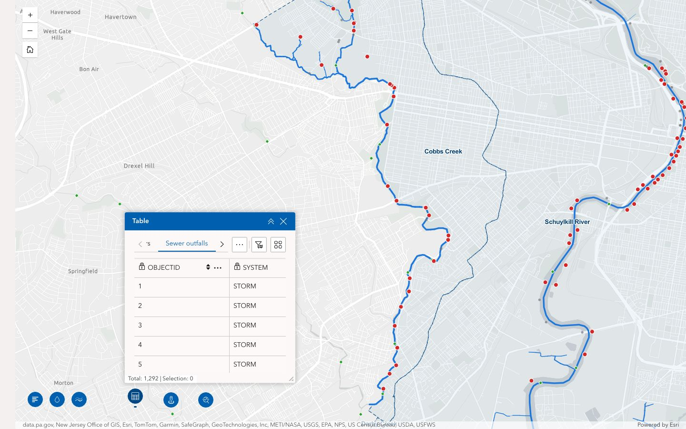

# Philadelphia Water Routes

> Branch: `philly-water-routes` · ArcGIS Experience Builder 1.20 (Developer Edition)

A spatial analysis of Philadelphia's creeks, watersheds and sewer outfalls, built as three custom Experience Builder widgets plus built-in Table, Analysis and Business Analyst widgets.

The main question: **which creeks carry the most pressure from combined sewer overflows**, where outfalls carry both sewage and stormwater and discharge into creeks during heavy rain?

The general Experience Builder setup and the other custom widgets are described in the README on `main`.



## Findings

Overlaying each watershed on the creek network and the city's 1,292 sewer outfalls:

| Watershed | Creek miles | Outfalls | Combined sewer outfalls (CSO) | CSO per creek mile |
|---|---:|---:|---:|---:|
| Delaware Direct | 4.2 | 122 | 38 | **9.09** |
| Tookany/Tacony-Frankford | 7.0 | 84 | 26 | **3.74** |
| Cobbs Creek | 10.7 | 44 | 34 | **3.16** |
| Schuylkill River | 36.1 | 262 | 43 | 1.19 |
| Pennypack Creek | 29.8 | 162 | 5 | 0.17 |
| Darby Creek | 1.2 | 2 | 0 | 0.00 |
| Poquessing Creek | 29.9 | 353 | 0 | 0.00 |
| Wissahickon Creek | 22.8 | 162 | 0 | 0.00 |

Combined sewer outfalls are concentrated in the older urban core, along the Delaware riverfront and in the Tacony-Frankford and Cobbs Creek watersheds. The Wissahickon, Poquessing and Darby watersheds have none.

A 300 ft corridor along each side of **Cobbs Creek** (8.1 mi, 586 acres) contains 22 combined sewer outfalls, or 2.72 per mile. The same corridor along **Pennypack Creek** (10.7 mi) contains 5, or 0.47 per mile.

*The figures come from live data and were last checked 21 Oct 2026. Running the widgets again recalculates them.*

## Running it

1. Start the server and client as described on `main` (`server: npm start`, `client: npm start`).
2. Open the app: **https://localhost:3001/experience/2/**, or open *Philadelphia Water Routes* in the builder.

The custom widgets don't need sign-in; the city layers are public. The built-in **Analysis** and **Business Analyst** widgets need an ArcGIS sign-in with the right privileges, and they use credits.

## Widgets

All three are in the **Water Tools** controller at the bottom left of the map.

| Widget | Folder | What it does |
|---|---|---|
| **Watershed Ranking** | `water-watersheds` | Overlays each watershed polygon on the creeks, outfalls and sampling sites. Ranks watersheds by CSO per creek mile. Click a row to zoom to that watershed. |
| **Rain Drop** | `water-raindrop` | Click the map to see which watershed the spot drains to, the nearest creek and how far away it is, and the nearest combined sewer outfall. It only listens for clicks while its panel is open. |
| **Creek Corridor** | `water-corridor` | Choose a creek and a width (50–1,000 ft each side). Draws a geodesic buffer around the creek and counts the outfalls and sampling sites inside it. |





Each widget's settings let you pick the map. If none is picked, the first Map widget on the page is used. Creek Corridor also has a default width setting.

### Built-in widgets in the app

- **Table** (map mode): lists the city layers the widgets add to the map. For example, filter *Sewer outfalls* for `outfall_type = COM` to list the combined sewer outfalls.
  

- **Analysis** has three tools, each adding its result to the map with export allowed:
  - **Enrich Layer** on Watersheds: demographics per watershed, to compare with the CSO ranking.
  - **Find Hot Spots** on Sewer outfalls, with Watersheds as the bounding area: statistically significant clusters of outfalls.
  - **Summarize Center and Dispersion** on Sewer outfalls, grouped by `outfall_type`: compares where combined and storm outfalls are spread.
- **Business Analyst**: infographics for a drawn area or a census geography. For example, draw over a Creek Corridor result to see who lives along the creek.

## Data

The data isn't stored in the repo. The widgets query the City of Philadelphia / Philadelphia Water Department's public ArcGIS Online services live:

| Layer | Service |
|---|---|
| Creeks & rivers (8,590 lines, ~3,000 in the city) | [Hydrographic_Features_Arc](https://services.arcgis.com/fLeGjb7u4uXqeF9q/ArcGIS/rest/services/Hydrographic_Features_Arc/FeatureServer/0) |
| Watersheds | [Major_Watersheds_Phila](https://services.arcgis.com/fLeGjb7u4uXqeF9q/ArcGIS/rest/services/Major_Watersheds_Phila/FeatureServer/0) |
| Sewer outfalls (1,292; 170 combined) | [OUTFALLS](https://services.arcgis.com/fLeGjb7u4uXqeF9q/ArcGIS/rest/services/OUTFALLS/FeatureServer/0) |
| Stream sampling sites (339) | [StreamSamplingLocations](https://services.arcgis.com/fLeGjb7u4uXqeF9q/ArcGIS/rest/services/StreamSamplingLocations/FeatureServer/0) |

The URLs are defined in one place: `client/your-extensions/widgets/shared-code/lib/philly-water/layers.ts`.

## Method notes

- **City only.** The creek layer covers the surrounding counties too, so it's filtered with `county LIKE 'Philadelphia%'`.
- **Creek lengths come from the geometry, not the `rivermile` field.** `rivermile` is a distance-from-the-mouth marker; adding it up gives nonsense (284 "miles" of Schuylkill inside the city). Lengths are the service's `Shape__Length` corrected for Web Mercator stretch at 40°N (× cos 40°). That gives 17.3 mi for the Schuylkill in the city, which matches reality. Corridor lengths and areas use geodetic operators directly.
- **Overlay counts are intersections.** A creek segment that crosses a watershed boundary counts in both watersheds, so watershed creek miles slightly overlap.
- **Creeks are shown at every zoom level.** The service hides creek lines beyond 1:150,000; the widgets override that so the whole city can be seen at once.
- **Basemap.** A Map widget with no web map uses the organisation's default basemap, which for UoM is GB Topographic and blank over Philadelphia. The widgets switch to Light Gray Canvas in that case.

## Code layout

```
client/your-extensions/widgets/
├── shared-code/
│   ├── philly-water.ts               # entry: import from 'widgets/shared-code/philly-water'
│   └── lib/philly-water/
│       ├── analysis.ts               # pure maths: unit conversion, ranking, formatting (unit-tested)
│       ├── layers.ts                 # layer definitions + one shared set of layers per map
│       ├── spatial.ts                # overlay, nearest-feature and buffer analyses
│       ├── use-water-map.tsx         # hook: connect to the map, own results layer, open/closed state
│       ├── ui.tsx                    # shared styles, status messages, legend
│       └── tests/analysis.test.ts
├── water-watersheds/
├── water-raindrop/
└── water-corridor/
server/public/apps/2/                 # the Philadelphia Water Routes app
```

All three widgets share one set of map layers. The first widget to connect adds them, and they're removed only after the last widget disconnects. Each widget draws its results on its own graphics layer and clears them when its panel closes.

### Tests and lint

```bash
cd client
npx jest your-extensions/widgets/shared-code
npx eslint your-extensions/widgets/shared-code your-extensions/widgets/water-*
```
