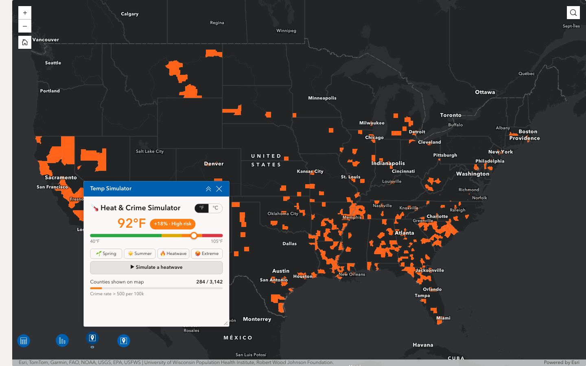
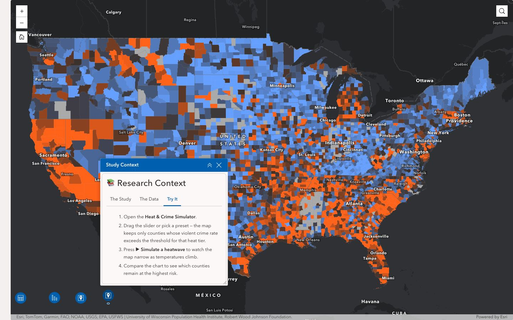

# ArcGIS Experience Builder: Custom Widgets

> Branch: `main` · ArcGIS Experience Builder 1.20 (Developer Edition) · University of Manchester ArcGIS Online

A local Experience Builder Developer Edition with a set of custom widgets and two apps:
- a University of Manchester campus app
- a Philadelphia heat-and-crime app

## Branches

| Branch | What it contains |
|---|---|
| `main` | The Experience Builder setup, the custom widgets below and apps 0–1 |
| `philly-water-routes` | A side project analysing Philadelphia's creeks, watersheds and sewer outfalls. It adds three widgets, shared code and app 2; see the README on that branch. |

## Apps

| App | Local URL | Custom widgets used |
|---|---|---|
| **UoM Energy Map** (app 0) | https://localhost:3001/experience/0/ | UoM Tour |
| **Philadelphia Crime & Temp Map** (app 1) | https://localhost:3001/experience/1/ | Temp Simulator, Study Context |





App 0's map is a University of Manchester web map. It doesn't load without signing in to the university's ArcGIS account. App 1 uses public data.

## Custom widgets

All of them are in `client/your-extensions/widgets/`.

| Widget | What it does |
|---|---|
| **Temp Simulator** (`temp-simulator`) | A slider sets the temperature and filters the County Health Rankings layer to counties whose violent crime rate passes a threshold for that heat tier. It also shows how many counties remain, has presets, a °F/°C toggle and a "simulate a heatwave" animation. The tiers are editable in settings. |
| **Study Context** (`study-context`) | Tabs explaining the heat–crime study, the data source and how to use the simulator. |
| **UoM Tour** (`uom-tour`) | Flies the map to campus landmarks, with a guided "next stop" tour. |
| **Campus Clock** (`campus-clock`) | Live Manchester time (Europe/London, BST/GMT) and date, whatever the viewer's own time zone. |
| **Campus Weather** (`campus-wheater`) | Live Manchester weather from Open-Meteo, which needs no API key: temperature, feels-like, high/low, humidity and wind. It refreshes every 15 minutes. |
| **Study Notes** (`study-notes`) | A to-do checklist saved in the browser, one list per widget. |
| **Info Card** (`info-card`) | A minimal title-and-text card edited from its settings. Handy as a template, or for checking that the builder's settings panel works. |
| **Simple** (`simple`) | Esri's sample starter widget. |

The `campus-wheater` folder name is a typo for "weather". It's kept because renaming the folder changes the widget's URI and breaks apps that already use it.

## Getting started

Requirements: Node.js 20 (developed on 20.18) and an ArcGIS Online account. This project uses the University of Manchester organisation, `https://uomanchester.maps.arcgis.com`.

```bash
# 1. Install dependencies (once)
cd server && npm ci
cd ../client && npm ci

# 2. Start the server (terminal 1)
cd server && npm start         # https://localhost:3001

# 3. Build the widgets and rebuild on change (terminal 2)
cd client && npm start
```

Then open **https://localhost:3001**.
- **First run:** Experience Builder asks for your ArcGIS organisation URL and an app client ID. That's saved in `server/public/signin-info.json`, which is not committed.
- **Signing in:** use *Your ArcGIS organization's URL* → `uomanchester`, then your university login.
- **Browser warning:** expected. The server uses a self-signed certificate in `server/cert/` (also not committed).

New widget folders are only picked up when `npm start` in `client/` starts. Restart it after adding a widget.

## Tests and lint

```bash
cd client
npx jest your-extensions/widgets        # unit tests
npx eslint your-extensions/widgets      # lint
```

Lint reports `jimu-theme/no-classic-css-utilities` for Bootstrap classes such as `text-muted` and `bg-white`. Those come from the classic theme and are left as they are for now.

## Gotchas

- **Settings panel stuck on a spinner:** this happens to a widget instance saved with `"config": null`, which is what you get if it was added before the widget had a `config.json`. Re-add the widget from *Insert widget → Custom* and delete the old copy. Every custom widget here ships a non-empty `config.json` so new instances don't hit this.
- **Edits to app config files:** if you edit `server/public/apps/<id>/config.json` by hand, reload the builder before saving there. Otherwise the builder's in-memory copy overwrites the file.

## What's not committed

`node_modules/`, the build output in `client/dist/`, the local certificate in `server/cert/` and `server/public/signin-info.json`. See `.gitignore`.
